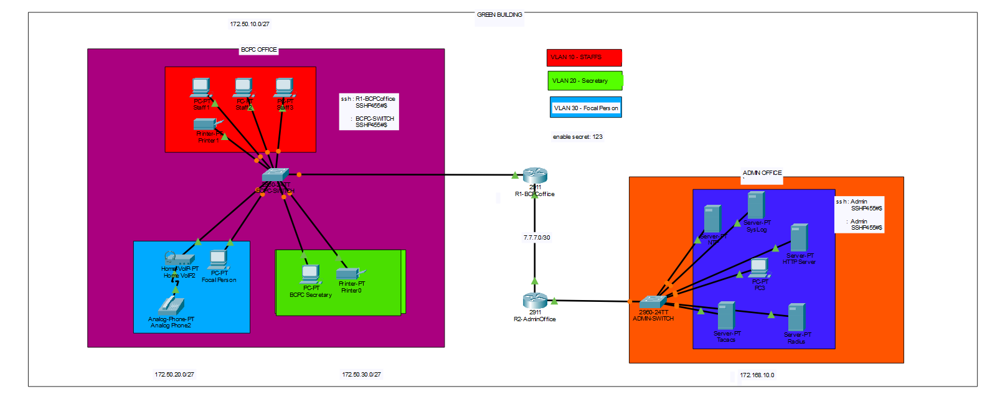

# BCPC Network Infrastructure Project

## 📌 Project Overview

The **BCPC Network Infrastructure Project** is a network design and infrastructure simulation developed using Cisco Packet Tracer.

This project demonstrates the implementation of network routing, switching, VLAN segmentation, trunking, centralized server services, network monitoring, time synchronization, web hosting, centralized authentication, and secure remote device administration.

The infrastructure is designed to provide reliable network communication, logical network segmentation, centralized management, and improved network security.

## 🎯 Project Objectives

- Design and simulate a functional network infrastructure.
- Implement VLANs for logical network segmentation.
- Configure trunk links for VLAN communication between switches.
- Implement static routing between different networks.
- Configure centralized network services.
- Deploy HTTP, Syslog, and NTP servers.
- Implement RADIUS and TACACS+ authentication.
- Configure SSH for secure remote administration.
- Demonstrate network connectivity, monitoring, and security.

## 🏗️ Network Infrastructure and Services

### 1. VLAN (Virtual Local Area Network)

Implements VLANs to logically segment a switched network into separate broadcast domains.

**Key Functions:**
- Create and configure VLANs on switches.
- Assign switch ports to specific VLANs.
- Separate network devices into logical groups.
- Improve network organization and traffic isolation.
- Reduce unnecessary broadcast traffic between VLANs.

### 2. Trunking (IEEE 802.1Q)

Implements trunk links to carry traffic from multiple VLANs across interconnected switches.

**Key Functions:**
- Configure trunk ports between switches.
- Implement IEEE 802.1Q VLAN tagging.
- Allow multiple VLANs to traverse a single physical link.
- Configure allowed VLANs on trunk connections.
- Maintain VLAN connectivity across switches.

### 3. Static Routing

Implements manually configured routing entries to enable communication between different networks.

**Key Functions:**
- Configure static routes on routers.
- Establish communication between remote networks.
- Define destination networks and next-hop addresses.
- Verify routing paths and end-to-end connectivity.
- Support communication between different network segments.

### 4. HTTP Server (Web Server)

Provides web hosting services within the network, allowing users to access hosted web pages through a browser.

**Key Functions:**
- Host an internal website.
- Provide web-based access to network resources.
- Demonstrate HTTP client-server communication.

### 5. Syslog Server (Network Logging)

Provides centralized logging by collecting system messages and event notifications from network devices.

**Key Functions:**
- Monitor network device activities.
- Collect system logs and event messages.
- Assist in troubleshooting.
- Maintain centralized network event records.

### 6. NTP Server (Network Time Protocol)

Provides centralized time synchronization for network devices.

**Key Functions:**
- Synchronize device clocks.
- Maintain consistent timestamps.
- Improve accuracy of network logs.
- Support network monitoring and troubleshooting.

### 7. RADIUS Server (Remote Authentication Dial-In User Service)

Provides centralized Authentication, Authorization, and Accounting (AAA) services for supported network access devices.

**Key Functions:**
- Centralized user authentication.
- Manage network access credentials.
- Support centralized access control.
- Demonstrate AAA implementation.

### 8. TACACS+ Server (Terminal Access Controller Access-Control System Plus)

Provides centralized AAA services, particularly for administrative access to network devices.

**Key Functions:**
- Centralized administrator authentication.
- Support authorization of administrative commands.
- Improve accountability for network administration.
- Demonstrate centralized device management.

### 9. SSH (Secure Shell)

Implements SSH to provide encrypted remote access to network devices, allowing administrators to securely manage and configure routers and switches.

**Key Functions:**
- Enable secure remote access to routers and switches.
- Configure SSH for encrypted administrative sessions.
- Generate RSA cryptographic keys.
- Configure local usernames and passwords.
- Restrict remote device management through SSH.

**Purpose:**

SSH provides a more secure alternative to Telnet by encrypting communication between administrators and network devices, protecting login credentials and administrative sessions.

## 🛠️ Technologies and Tools Used

| Technology | Purpose |
|---|---|
| Cisco Packet Tracer | Network simulation |
| VLAN | Logical network segmentation |
| IEEE 802.1Q | VLAN trunking |
| Static Routing | Inter-network communication |
| SSH | Secure remote administration |
| HTTP | Web hosting |
| Syslog | Centralized logging |
| NTP | Time synchronization |
| RADIUS | Centralized authentication |
| TACACS+ | Administrative AAA |
| IPv4 | Network addressing |
| TCP/IP | Network communication |

## 🖥️ Network Architecture

The simulated infrastructure consists of interconnected routers, switches, servers, and client devices.

VLANs provide logical network segmentation, while trunk links transport multiple VLANs across interconnected switches.

Static routing enables communication between different networks, while dedicated servers provide centralized network services.

SSH provides secure remote administration, and RADIUS and TACACS+ demonstrate centralized authentication and authorization.

### Network Topology

## 📂 Project Files

| File | Description |
|---|---|
| `BCPCNetwork.pkt` | Cisco Packet Tracer network simulation |
| `topology.png` | Network topology diagram |
| `README.md` | Project documentation |

## 🧪 Testing and Verification

The following tests can be performed to verify network functionality:

- **VLAN:** Verify VLAN creation and port assignments using `show vlan brief`.
- **Trunking:** Verify trunk interfaces using `show interfaces trunk`.
- **Static Routing:** Verify routing tables using `show ip route` and test connectivity using ping.
- **HTTP:** Access the hosted website using a client web browser.
- **Syslog:** Verify that network device messages are received by the Syslog server.
- **NTP:** Verify time synchronization on supported network devices.
- **RADIUS:** Test centralized authentication on supported devices.
- **TACACS+:** Test administrator authentication and command authorization where supported.
- **SSH:** Verify encrypted remote access to routers and switches.

## 🔐 Network Security and Management

The project demonstrates network segmentation, centralized authentication, secure remote administration, and network monitoring.

Security and management implementations include:

- VLANs for logical network separation.
- Trunking for controlled VLAN transport.
- SSH for encrypted remote device management.
- RADIUS for centralized authentication.
- TACACS+ for centralized administrative AAA.
- Syslog for network event monitoring.
- NTP for consistent timestamps.

## 🚀 How to Access the Project

1. Download or clone this GitHub repository.
2. Download the `BCPCNetwork.pkt` file.
3. Open Cisco Packet Tracer.
4. Navigate to **File → Open**.
5. Select the downloaded `.pkt` file.
6. Explore the network topology and server configurations.

## 📚 Learning Outcomes

Through this project, the following networking concepts are demonstrated:

- Network infrastructure design.
- VLAN configuration and network segmentation.
- Switch trunking and IEEE 802.1Q.
- Static routing configuration.
- Server deployment and configuration.
- Centralized authentication and authorization.
- Network monitoring and logging.
- Network time synchronization.
- Secure remote device administration.
- Client-server communication.
- Network troubleshooting and administration.

## 👨‍💻 Project Information

**Project Name:** BCPC Network Infrastructure Project

**Platform:** Cisco Packet Tracer

**Category:** Computer Networking / Network Administration

**Project Type:** Network Design and Infrastructure Simulation

---

*This project was developed for educational purposes to demonstrate practical networking, switching, routing, server infrastructure, centralized authentication, and network management concepts.*
